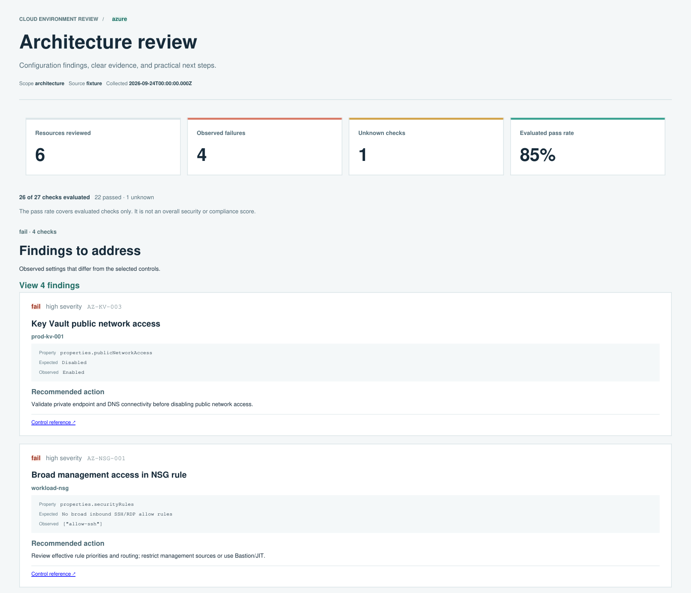

# CloudSkills

CloudSkills is a local cloud architecture and FinOps toolkit with a Model Context Protocol (MCP) server, a deterministic CLI and reusable agent skills. **Azure is the only implemented provider.** The core uses provider-neutral contracts so that AWS and GCP adapters can be added later; those providers currently have placeholders only.

The engine collects read-only evidence, checks selected controls, stores organization policy locally and generates HTML, JSON and Mermaid review artifacts. It does not require an AI service or GitHub to run. Agent clients add conversational orchestration and interpretation.

## Report preview



Offline-rendered preview of the synthetic report from `examples/subscription.json`, with a document layout adapted for the image. It contains no real tenant findings; the interactive browser layout differs. Run `npm run demo` to generate the HTML report locally.

The package/server are renamed to CloudSkills. This local checkout currently remains at `C:/Users/jahmed/Desktop/Junaid/AzureSkills`: Windows blocked the physical rename while the workspace was open. Run the commands below from the existing checkout, or follow [the folder migration steps](docs/MIGRATION.md) after closing it. VS Code configuration using `${workspaceFolder}` works from either folder name.

## Quick start: no AI or GitHub required

Requires Node.js 24 LTS and npm. JavaScript runs directly; Node strips the erasable TypeScript used by the provider contracts and registry. There is no application bundle/build step.

```sh
cd CloudSkills
npm ci
npm run check
npm run typecheck
npm test
npm run demo
```

Open `reports/demo/report.html`. The synthetic demo includes a report, JSON evidence, three Mermaid diagrams, two Azure Terraform JSON examples and an artifact manifest. Existing artifacts are never overwritten. For another run, choose a fresh output directory:

```sh
npm run audit -- --provider azure --input examples/subscription.json --output reports/demo-2
```

For local live Azure reads, authenticate with `az login`, use the subscription UUID, and set the explicit allowlist before running:

```powershell
$env:AZURE_SUBSCRIPTIONS = "your-subscription-uuid"
npm run audit -- --provider azure --subscription $env:AZURE_SUBSCRIPTIONS --output reports/live-review
```

Azure is the default for compatibility. The standard CLI report covers inventory configuration checks. Add `--assessment` to create a linked Markdown brief and JSON evidence bundle with Azure Policy states, RBAC, resource PIM, month-to-date costs and cached Azure Advisor recommendations.

```powershell
npm run audit -- --subscription $env:AZURE_SUBSCRIPTIONS --assessment --output reports/live-assessment
```

Start with `assessment.md`. Each subscription has its own evidence and collection status. A denied or failed supplemental read is marked unavailable and the rest of the report is still written. Cost is grouped by currency and an empty billing response is marked unknown. Advisor data uses [Azure's cached recommendations](https://learn.microsoft.com/en-us/rest/api/advisor/recommendations/list?view=rest-advisor-2025-01-01). Check recommendation freshness and suppressions before acting.

Add approved organization controls to an offline review:

```sh
npm run audit -- --input examples/subscription.json --policy examples/organization-controls.json --output reports/with-policy
```

The comparison is saved as `organization-policy.json`. Combine `--assessment` with `--policy` to include the comparison summary in the brief. A snapshot-based assessment works offline and labels live evidence as uncollected. `--fail-on-findings` returns 2 for built-in or local organization control failures. Input errors and failed inventory collection return 1. Supplemental evidence status is included in the JSON output and does not change those exit codes.

## How users interact

**Windows and VS Code Copilot** · Double-click [`Start-CloudBuild.cmd`](Start-CloudBuild.cmd) in your local CloudSkills checkout and select your application folder. It installs `/cloud-build` for that project and opens the infrastructure interview in Copilot. [Setup and manual alternatives](docs/SERVICE-BUILDER.md)

To design new Azure infrastructure, invoke `cloud-build` in your application workspace. The guided interview records decisions in a Markdown document and can produce Terraform or an Azure PowerShell script for review. [Invocation commands and examples](docs/SERVICE-BUILDER.md)

Use the CLI for repeatable reports, or connect an MCP client and talk to it in chat. To start from what you want to build, with policy checked first, use the `cloudskills` skill:

```text
/cloudskills help me create a web app
```

It reads your Azure Policy assignments, imported organization controls and the matching CloudSkills template, then asks you one design question at a time, each with its recommendation and the evidence behind it. Every decision is recorded under `services/<workload>/<run>/`, and `cloud-build` then generates the Terraform from those decisions. [Chat with CloudSkills](docs/SKILLS.md#chat-with-cloudskills) shows a full exchange.

For an assessment, name the workflow in natural language:

> Use the cloud-architecture-finops skill to review subscription contoso-prod. Check Azure's evaluated policy compliance and our imported organization controls, explain cost evidence and gaps, and save the report with supporting evidence in the dedicated working folder.

A skill is a workflow instruction file. Tools perform collection and checks. Authentication, MCP configuration and imported organization controls must be available separately. **No organization policy is discovered or learned automatically merely by installing a skill.** [Policy learning](docs/POLICY-LEARNING.md) explains Azure-evaluated states versus local baseline comparisons. [AI client setup](docs/CLIENTS.md) covers VS Code Copilot, Visual Studio Copilot, Claude Code, Cursor and other compatible clients, including skill locations, MCP commands and example requests.

## MCP setup

The canonical entry point is `src/server.js`; `mcp/server/index.js` remains a compatibility entry point. Existing 22 tool names, including `azure_*`, remain available. Clients use different configuration formats: this generic example uses `mcpServers`, while VS Code `.vscode/mcp.json` uses `servers`.

```json
{
  "mcpServers": {
    "cloudskills": {
      "command": "node",
      "args": ["C:/path/to/CloudSkills/src/server.js"],
      "env": {
        "POLICY_DATABASE": "C:/path/to/CloudSkills/knowledge/organization/policies.db",
        "AZURE_SUBSCRIPTIONS": "your-subscription-uuid"
      }
    }
  }
}
```

Use your actual absolute installation path. `npm start` starts STDIO; stdout is reserved for MCP. Azure uses `DefaultAzureCredential`, supporting configured service principals, managed identity and a local Azure CLI login. An empty subscription allowlist disables live collection.

HTTP requires a random bearer token of at least 32 characters:

```powershell
$env:MCP_AUTH_TOKEN = node -e "console.log(require('node:crypto').randomBytes(32).toString('hex'))"
npm run start:http
```

Connect to `http://127.0.0.1:3000/mcp` with `Authorization: Bearer <token>`. Configure environment variables directly or use `node --env-file=.env src/server.js --transport http`; the application does not automatically read `.env`. HTTP is a trusted-client, single-organization deployment using a shared token. See [MCP contracts](docs/MCP.md) and [security](docs/SECURITY.md).

## Capabilities and limits

| Area | Tools and supported behavior |
|---|---|
| Azure collection | `azure_inventory`, `azure_resource_graph`: paginated Resource Graph reads, explicit subscription allowlist, bounded inventory cache |
| Azure reviews | `azure_architecture_review`, `azure_security_audit`, `azure_identity_audit`, `azure_network_audit`, `azure_waf_review`: selected Key Vault, Storage, App Service, NSG and sample tag checks |
| Specialized Azure evidence | `azure_rbac_audit`, `azure_pim_review`, `azure_policy_audit`, `azure_cost_analysis`: subscription role/PIM records, evaluated policy states and month-to-date actual costs |
| Organization knowledge | `learn_organization_policy`, `search_organization_policy`, `compare_policy_baseline`: validated controls in SQLite or PostgreSQL |
| Azure Terraform | `terraform_analyze`, `terraform_security_scan`, `terraform_generate`: JSON inspection and nine service templates; no provider execution |
| Diagrams | `generate_architecture_diagram`, `generate_network_diagram`, `generate_identity_diagram`: grouped Mermaid and graph JSON from normalized references |
| Reports | `generate_html_report`, `generate_json_report`: complete provider-neutral audit reports returned as content |

A clean result is not a full security, CAF, WAF, networking, identity or financial assessment. Identity tools do not collect Entra directory evidence. Cost evidence is month-to-date actual cost, not historical meter-level utilization or calculated savings. [Architecture](docs/ARCHITECTURE.md) lists coverage boundaries.

Supported Terraform generation kinds are `storage`, `keyvault`, `virtual-network`, `app-service`, `virtual-machine`, `sql-database`, `postgresql`, `aks` and `container-app`. Outputs include required inputs, a deployment checklist and `policyStatus: "not-evaluated"`. Templates provide starting configurations for review; organizational applicability and deployment requirements still need evaluation.

## Local Docker deployment

Docker is optional. Set `MCP_AUTH_TOKEN` before starting. Compose binds the published port to host loopback; SQLite persists in a named volume.

```powershell
$env:MCP_AUTH_TOKEN = node -e "console.log(require('node:crypto').randomBytes(32).toString('hex'))"
docker compose up --build -d
docker compose logs --tail 50
```

The image installs production dependencies separately from application sources so source changes can reuse the dependency layer. Node runs the same source entry point as the local server, with no transpilation at container startup. The container runs as a non-root user with a read-only root filesystem. The inventory cache is process-local and is lost on restart.

For live reads, supply the allowlist and supported Azure credential variables through the deployment's secret mechanism. Your host's `az login` is not automatically available inside the container. A local test with a read identity is required to establish endpoint access.

Optional PostgreSQL policy storage:

```powershell
# Set POSTGRES_PASSWORD to a strong, URL-safe secret in the environment first.
docker compose -f docker-compose.yml -f docker/postgres.compose.yml up --build -d
```

Stop without deleting retained data using `docker compose down` (use both Compose files when running PostgreSQL). Docker build and live database validation status is recorded in [Validation](docs/VALIDATION.md).

## Provider architecture and roadmap

```text
src/
  core/                  MCP transport/router, contracts, reporting, policy, cache, graphs
    interfaces/index.ts  ICloudInventory, ICloudCost, ICloudPolicy and evidence contracts
  providers/
    azure/               ARM authentication/collection, normalization, rules and tools
    aws/                 Placeholder; planned, not implemented
    gcp/                 Placeholder; planned, not implemented
  bootstrap.js           Concrete provider registration and dependency injection
  server.js              Canonical MCP entry point
  cli/                   Local audit orchestration
```

Core reporting and storage consume normalized data and have no Azure SDK dependency. Azure native behavior stays in its adapter. Existing import/entry paths are retained as compatibility shims. Future providers must implement the contracts, normalize their references and register their tools; adding placeholders does not enable collection.

The repository contains 15 agent workflows in `.agents/skills/`. Supported Copilot and Cursor versions discover them there; Claude Code uses a documented `.claude/skills/` installation step. [AI client setup](docs/CLIENTS.md), [Skills](docs/SKILLS.md), [Copilot](docs/COPILOT.md), [Architecture](docs/ARCHITECTURE.md), [MCP](docs/MCP.md), [Policy learning](docs/POLICY-LEARNING.md), [Security](docs/SECURITY.md), [Validation](docs/VALIDATION.md).

Generated tenant reports, policy databases, credentials and dependency folders are ignored by Git. Review organizational evidence before sharing it through any external AI client. No deployment, remediation or deletion tools exist.


