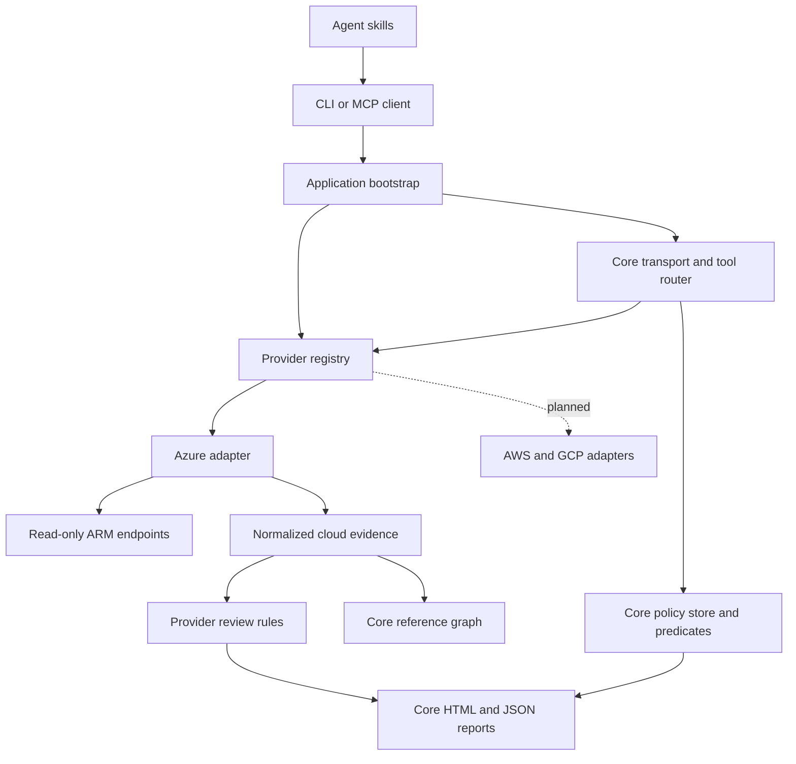

# CloudSkills architecture

CloudSkills separates provider-neutral infrastructure from native cloud behavior. Azure is the only registered provider; AWS and GCP directories are roadmap placeholders.

## Layout and dependencies

| Location | Responsibility |
|---|---|
| `src/core/interfaces/index.ts` | SDK-free contracts for resources, inventory, costs, policies, findings, reports and provider adapters |
| `src/core/providers.ts` | Injected provider registry, duplicate detection and explicit unsupported-provider errors |
| `src/core/mcp/` | STDIO/HTTP server infrastructure, authentication, generic tools and validation |
| `src/core/reporting/` | Provider-neutral JSON validation, escaped HTML and inline responsive/print CSS |
| `src/core/policy/` | Validated normalized controls, SQLite/PostgreSQL persistence and comparisons |
| `src/core/cache/` | Bounded LRU cache and concurrent-load coalescing |
| `src/core/diagrams/` | Generic graphs from normalized references; no inference from provider SDK objects |
| `src/providers/azure/` | Azure authentication, ARM endpoints, collection, normalization, policy translation, analyzers, Terraform, tools, resources and prompts |
| `src/providers/aws/`, `src/providers/gcp/` | Placeholders only |
| `src/bootstrap.js` | Composition root: selects the Azure implementation and injects registry/store/tool registration |
| `src/server.js`, `src/cli/` | MCP entry point and local audit orchestration |

Legacy `mcp/` and original `src/` module paths remain compatibility facades. New functionality should use `src/core/` or `src/providers/<provider>/`. Generic core modules do not import concrete providers. The composition root makes that selection explicitly.

Node.js 24 runs JavaScript and strips erasable TypeScript syntax in the contracts, registry and adapter. `npm run typecheck` checks these boundaries using `tsc --noEmit`. There is no runtime bundler. The official MCP SDK, Zod, Azure Identity and built-in SQLite remain in use; `pg` is optional policy persistence. No model API, embedding service or telemetry service is included.

## Provider contracts

`ICloudInventory.getInventory(scope, options)` returns an `ICloudSnapshot`; `ICloudCost.getCost(scope)` returns per-currency totals and resource amounts. `ICloudPolicy.importPolicies(definitions)` translates native definitions into normalized `ICloudControl` entries and explicitly unsupported entries. `ICloudProvider` also supplies `normalize()` and `review()`. `IPolicyStore` accepts normalized controls, independent of cloud SDKs.

A generic scope uses `accountIds`; resources use `accountId`, `region`, `group`, `kind`, `properties`, `tags` and explicit `references`. A snapshot identifies its provider, coverage, limitations and content hash. Reports use `ICloudReport` and findings with pass/fail/unknown evidence. Provider extensions may remain on resources for existing consumers; the core does not interpret Azure-specific fields.

Generic normalization preserves resource ID case. Azure normalization owns ARM ID/type case semantics and translates location/subscription/resource group/reference data. Report presentation reads generic report fields and does not require Azure SDK objects. Policy storage validates generic controls rather than native Azure definitions; native translation belongs to the Azure adapter.

A future adapter must implement these contracts and be registered in the composition root. It needs its own authentication/allowlist, normalization and evidence checks; sharing an interface does not imply equivalent cloud service semantics. The `azure_*` tool names remain Azure-specific. Generic report, diagram and policy tools select the registry using a provider and normalized scope or snapshot.

## Azure collection and cache

Azure uses fixed ARM endpoint families and only GET or read/query POST calls. Explicit subscription UUIDs must be allowlisted before credentials are requested. Continuation links are validated against expected destination paths and origins. Repeated cursors, unsupported continuation states and collection limits produce errors instead of silent partial success.

Resource Graph inventory uses continuation pages and stable ordering. The public query tool returns its continuation cursor to the caller; full inventory collection walks pages internally before reviewing a snapshot. Specialized subscription RBAC/PIM, Policy Insights and Cost Management readers also follow their validated pagination paths.

Inventory cache limits are 60 seconds absolute TTL, 32 entries, 64 MiB total serialized UTF-8 bytes and 16 MiB per entry. Oversized snapshots can be returned but are not retained. Least recently used entries are evicted as needed. Values are isolated with structured clones so a caller cannot mutate retained evidence. Concurrent loads for the same subscription set are coalesced; failures clear the pending load so a later call can retry. Refresh bypasses a retained value while still joining a currently active collection for the same key. These bounds govern serialized retained data, not the entire Node heap or temporary collection memory.

## Evidence, policy and artifacts

Deterministic Azure predicates live in `src/providers/azure/analyzers.js`. Missing properties remain unknown. The observed pass percentage excludes unknowns and is not a comprehensive security score. Example governance tags are illustrative organization controls, not Microsoft requirements.

Policy imports validate, normalize and hash controls, then transactionally upsert by ID. The store has primary-key indexing; retrieval is a bounded literal-term search. Large catalogs may need text indexes or a search adapter. No automatic organization discovery, approval workflow or version history is implemented. See [Policy learning](POLICY-LEARNING.md).

Diagrams use explicit references to resources present in the same snapshot, with readable grouping and distinct node classes. Missing subnets, directory principals, implicit dependencies and runtime traffic do not produce invented edges. Mermaid is returned as source and graph JSON; HTML report generation does not fetch a remote renderer.

HTML reports use an inline stylesheet, clear evidence/status presentation, responsive tables and print styling. They escape untrusted evidence and do not load scripts, fonts or styles from a network location. JSON reports retain the versioned evidence contract. MCP returns artifact contents; clients choose where to save them. The CLI writes a reproducible bundle and refuses to overwrite previous files.

## Coverage boundaries

- Azure rules cover selected Key Vault, Storage, App Service and NSG settings plus sample governance tags.
- WAF reuses these configuration checks. Reliability, operations, performance and cost trade-offs require workload requirements and further evidence.
- RBAC flags selected privileged built-in roles; custom role definitions, group membership and inherited management-group assignments are outside coverage.
- Resource PIM reviews assignment instances for absent end times; Entra directory PIM and activation policy are outside coverage.
- Cost data is actual month-to-date, grouped by currency, with top resources. There are no utilization or savings estimates.
- Azure Policy state reads use Azure's evaluated states. Local native-definition imports support a narrow subset and do not resolve full assignments, initiatives, exemptions or scope applicability.
- Terraform accepts `.tf.json` or `terraform show -json`, not raw HCL. It does not run providers or load modules from disk. Nine Azure service template kinds provide requirements/checklists and an explicit unevaluated policy status; they are starting configurations requiring workload-specific inputs and review.
- CLI reports cover inventory checks. Separate live RBAC, PIM, cost and policy-state results are not aggregated into that report automatically.

There are no deployment/remediation tools. AWS and GCP collection, checks and credentials are planned future work, not enabled features.

